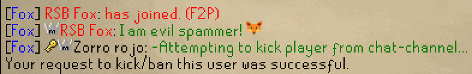
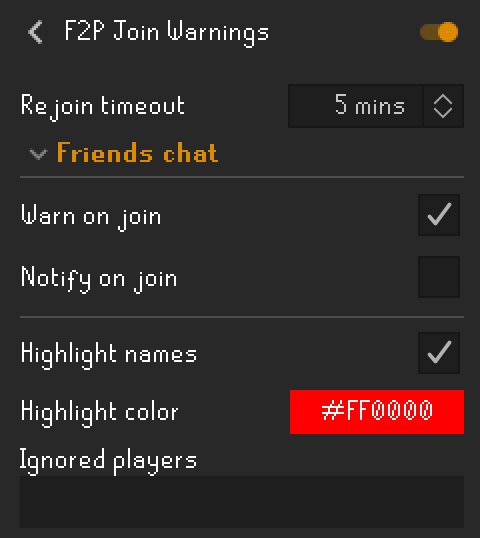

# F2P Join Warnings

Warns you when an unranked free-to-play account joins your friends chat.

## What it does

When someone with no rank joins while on a F2P world, the plugin posts a warning in your chat (and optionally sends a notification).
Their name is also highlighted in the member list and in chat messages for as long as they stay flagged.

You can exclude specific players, and set how long to wait before warning about the same person again if they leave and rejoin.

## Settings

- `Rejoin timeout`: Time before warning again on rejoin. 0 to always warn.  
- `Warn on join`: Display a warning when an unranked F2P player joins.  
- `Notify on join`: Send a notification when an unranked F2P player joins.  
- `Highlight names`: Highlight flagged player names in chat messages and the member list.  
- `Highlight color`: Set the color of the warning message and name highlights.  
- `Ignored Players`: Players who are never warned about or highlighted. Comma-separated, case-insensitive.